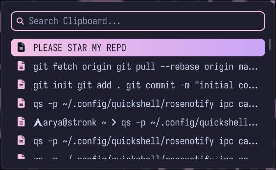

# roseclip

A fast, keyboard-driven clipboard manager for Wayland, built on Quickshell.

  

---

## requirements

- linux + wayland — roseclip is a Wayland-only tool.
- quickshell (https://github.com/quickshell-mirror/quickshell) — required to run the shell.
- cliphist — the backing clipboard history store.
- wl-clipboard (wl-paste, wl-copy) — clipboard I/O and watch mode.
- wtype (default) — used by behavior.paste_command to auto-paste; swap for your compositor's key injector if needed.
- coreutils — used by the installer for file operations.
- a Nerd Font — recommended, since the default icons are Nerd Font glyphs (\uf002, \uf15c, \uf1c5).

Make sure any extra tools referenced by your configuration (e.g. a custom paste_command) are installed and on your PATH.

---

## installation

Clone the repository and run the installer:

    git clone https://github.com/sappyware/roseclip.git
    cd roseclip
    chmod +x install.sh
    ./install.sh

The installer copies the QML files into ~/.config/quickshell/roseclip/ and seeds ~/.config/roseclip/config.toml if it does not already exist.

Config path can be overridden with the ROSECLIP_CONFIG environment variable. The runtime cache directory is ${XDG_RUNTIME_DIR}/roseclip (falls back to /tmp/roseclip).

---

## running

roseclip runs in one of two modes, set by behavior.mode:

daemon (default) — keep it running and toggle on demand:

    qs -c roseclip

oneshot — run per use (qs -c roseclip opens, picks, exits):

    [behavior]
    mode = "oneshot"

Toggle via IPC:

    qs ipc call roseclip toggle
    qs ipc call roseclip open
    qs ipc call roseclip close

Example usage in MangoWM:

    exec_once=qs -c roseclip

---

## configuration

Config file is located at ~/.config/roseclip/config.toml (override with ROSECLIP_CONFIG). The file is watched — changes apply live.

    # roseclip config

    theme = "catppuccin-mocha"    # catppuccin-mocha | catppuccin-latte | nord | gruvbox | tokyonight | rose-pine | dracula

    [window]
    width        = 560            # clamped 200..4000
    radius       = 12
    padding      = 20
    gap          = 16
    border_width = 1
    opacity      = 0.97           # 0..1
    dim          = 0.0            # background dim behind the card, 0..1
    offset_y     = 0
    monitor      = ""             # "" = any; else match an output name

    [search]
    height       = 40
    radius       = 10
    border_width = 2
    padding_x    = 12
    placeholder  = "Search..."
    icon         = "\uf002"
    icon_size    = 16

    [list]
    visible_rows  = 6.5           # 1..30
    row_height    = 36
    row_gap       = 2
    row_radius    = 10
    padding_x     = 8
    icon_size     = 26
    icon_gap      = 12
    thumb_width   = 44            # image preview width (height = row_height - 8)
    text_icon     = "\uf15c"
    image_icon    = "\uf1c5"
    show_icons    = true
    shrink_to_fit = true          # shrink list when fewer results than visible_rows
    scrollbar     = true
    scrollbar_gap = 8
    empty_text    = "No results"

    [font]
    family          = ""          # empty = system default
    size            = 15
    weight          = "normal"    # thin..black, or numeric 1..1000
    selected_weight = "normal"
    italic          = false
    letter_spacing  = 0

    [behavior]
    mode            = "daemon"    # "daemon" (keep running, bind toggle) | "oneshot" (run `qs -c roseclip` per use)
    watch_clipboard = true        # daemon mode: start the wl-paste/cliphist watchers (oneshot: run them yourself)
    max_results     = 200
    preview_chars   = 200         # text length cliphist keeps per entry (search runs on this)
    auto_paste      = true
    paste_delay_ms  = 120
    paste_command   = "wtype -M ctrl v -m ctrl"   # terminals: "wtype -M ctrl -M shift v -m shift -m ctrl"
    close_on_click_outside = true
    wrap            = true        # wrap up/down at list ends
    hover_select    = true

    [animation]
    enabled     = true
    duration_ms = 120
    resize_ms   = 180

    [colors]                       # override single theme colors; "" = use theme
    bg = ""
    surface = ""
    border = ""
    fg = ""
    muted = ""
    accent = ""
    selected_from = ""
    selected_to = ""
    selected_fg = ""
    hover = ""
    urgent = ""

### themes

Built-in themes: catppuccin-mocha, catppuccin-latte, nord, gruvbox, tokyonight, rose-pine, dracula. Pick one with theme = "...", then override individual palette slots under [colors]. Invalid colors, unknown keys, and out-of-range numbers produce a warning shown at the bottom of the card instead of silently failing.

---

## keybindings

    Esc                       close
    Enter / Return            pick selected entry
    Down / Tab / Ctrl+J / Ctrl+N    move down
    Up / Shift+Tab / Ctrl+K / Ctrl+P  move up
    PageDown / PageUp         move a page
    Ctrl+U                    clear the search query
    Ctrl+D / Delete (empty query)  delete selected entry
    Ctrl+Shift+D              wipe all history

Delete only acts when the search box is empty, so it won't fight with text editing.

---

## search

Results are ranked with a field-aware fuzzy matcher (search.js):

- exact match -> 1000
- prefix match -> 800 (scaled by length)
- word-boundary substring -> 600
- any other substring -> 400
- otherwise fuzzy subsequence with bonuses for adjacency and word boundaries

Queries are whitespace-split; every token must match for a record to be kept. Ties preserve history order. Search runs against the cliphist preview (behavior.preview_chars), not the full entry.

Image entries are labelled as "Image  WxH  FORMAT  SIZE" and shown with a thumbnail cached under ${XDG_RUNTIME_DIR}/roseclip. Cache images older than a day are pruned on each open.

---

## ipc

roseclip exposes its surface on the roseclip target:

    qs ipc call roseclip toggle      # open if closed, close if open
    qs ipc call roseclip open        # open (reloads config)
    qs ipc call roseclip close       # close (respects daemon/oneshot mode)

---

## help me fix any bugs with PRs!

Source for roseclip. Screenshot file is roseclip.png.
